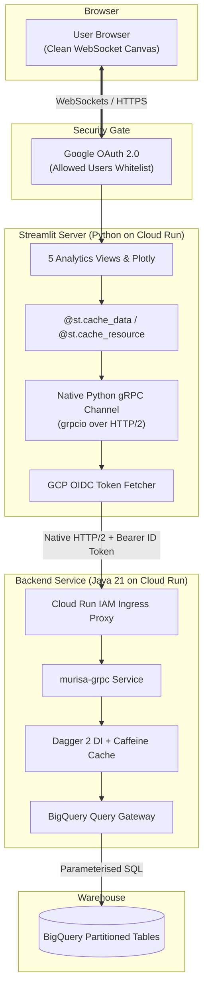

# Building a Low-Latency Sentiment Service: Java 21 gRPC, BigQuery, and Proxy-Free Streamlit

**Isaac Murisa** &bull; November 2026  
*Personal portfolio: [murisa.app](https://murisa.app)*

---

### TL;DR

- **The Problem**: Querying multi-year sentiment datasets in BigQuery for on-the-fly dashboard visualisations gets sluggish and clumsy when serialising heavy JSON over standard REST endpoints.
- **Why gRPC**: I wanted to get my hands dirty with gRPC in a real-world scenario. Protobuf contracts give you bulletproof, compile-time typing, tiny binary payloads, and multiplexed HTTP/2 streaming.
- **The gRPC Solution**: I built a Java 21 gRPC microservice (`murisa-grpc`) deployed on Google Cloud Run. It uses Dagger 2 for compile-time dependency injection, Caffeine for in-memory caching, and parameterised BigQuery SQL queries that prune date partitions early.
- **The Proxy Workaround**: Standard web browsers can't speak native gRPC directly, which usually forces you to run and babysit an Envoy proxy for `gRPC-Web` translation. We dodged that entirely by building the dashboard in Streamlit. Because Streamlit executes Python on the server, it acts as a native HTTP/2 gRPC client with GCP OIDC identity tokens. No Envoy, no translation overhead, no proxy headaches.
- **The Dashboard**: A focused analytics UI featuring five views: corpus-wide aggregates, entity rankings, individual deep-dives, period-over-period momentum, and public Google Trends search correlation.
- **The Evolving Developer**: This project was built pairing tightly with AI. It shifted how I think about engineering: AI has become the implementation engine, while the engineer's craft has evolved into writing rigorous specifications, architecting invariants, and inspecting generated code.

---

## 1. Why This Project?

Over the past few years, I’ve had millions of entity sentiment records sitting in a Google Cloud BigQuery dataset. Every record captures an entity mention with three key metrics:
1. **Sentiment score**: Polarity ranging from $-1.0$ (strongly negative) to $+1.0$ (strongly positive).
2. **Magnitude**: Emotional intensity or strength ($0.0$ upwards).
3. **Salience**: How central or prominent the entity was in context ($0.0$ to $1.0$).

Along with timestamps and taxonomy paths, this data offers a fascinating view into how people, organisations, places, and concepts trend over time.

The goal was straightforward: build an interactive dashboard where you can search any entity, see who’s gaining or losing favour, track volume spikes, and inspect daily sentiment curves—all with sub-second feedback.

Beyond the data itself, there was another big motivator: **I genuinely wanted to explore gRPC hands-on.** I wanted to see how it felt to build a production-grade service from scratch—defining Protobuf contracts, wiring up a high-performance Java backend, and seeing how smoothly a frontend could communicate with it.

---

## 2. The Browser gRPC Trap (and how we dodged it)

When designing the backend, gRPC was the obvious choice over REST/JSON. Strongly typed Protobuf schemas keep both ends in sync, binary payloads are compact, and HTTP/2 keeps connections persistent and multiplexed.

```
The Standard Head-Scratcher:
Browser (React / Vue)  ──[gRPC-Web / HTTP/1.1]──>  [ Envoy Proxy ]  ──[Native gRPC / HTTP/2]──>  Java Backend
```

The catch with gRPC has always been the browser. Standard browsers don’t give client-side JavaScript low-level access to HTTP/2 frames, trailers, or raw binary streams. In a traditional React or Vue Single Page Application (SPA), you are forced to place an **Envoy Proxy** in front of your service to transcode incoming `gRPC-Web` calls into native gRPC.

That means:
- Another container to configure, deploy, patch, and monitor in Google Cloud.
- Juggling SSL certificates, gRPC-Web filters, and annoying CORS policies.
- An extra network hop adding latency to every interaction.

### The Streamlit Alternative

Instead of building a decoupled client-side SPA, we used **Streamlit**:



In Streamlit, Python runs entirely on the server. The user’s browser only renders the visual components and sends interaction events back over a WebSocket connection.

Because our Python code is running on a server runtime, we don’t need `gRPC-Web`. We instantiate a **genuine Python `grpcio` client**. It opens a direct, multiplexed HTTP/2 channel straight to our Cloud Run Java service, attaching GCP OIDC bearer tokens automatically.

> **Key Result**: We get the full power of native gRPC—type safety, streaming, and speed—without deploying or maintaining a single proxy.

---

## 3. Backend Architecture: Java 21 & BigQuery

The backend service (`murisa-grpc`) is built on **Java 21** and Gradle. The codebase is organized cleanly around compile-time dependency injection and typed query processors.

### 3.1 The Protocol Buffer Contract (`trending.proto`)

Rather than a simple toy endpoint, the Protobuf schema covers core dashboard analytics, public trend integration, and AI agent tool calling:

```protobuf
syntax = "proto3";

package com.murisa.grpc.trending.v1;

option java_multiple_files = true;
option java_package = "com.murisa.grpc.trending.v1";

service SentimentAnalysisService {
  // --- Core Entity & Sentiment Analytics (Dashboard) ---
  rpc GetEntityCatalog(GetEntityCatalogRequest) returns (GetEntityCatalogResponse);
  rpc GetSentimentTimeSeries(GetSentimentTimeSeriesRequest) returns (GetSentimentTimeSeriesResponse);
  rpc GetSentimentDailyAggregates(GetSentimentDailyAggregatesRequest) returns (GetSentimentDailyAggregatesResponse);
  rpc CompareSentimentPeriods(CompareSentimentPeriodsRequest) returns (CompareSentimentPeriodsResponse);
  rpc GetWeightedSentimentRanking(GetWeightedSentimentRankingRequest) returns (GetWeightedSentimentRankingResponse);
  rpc GetEntityMentionTrends(GetEntityMentionTrendsRequest) returns (GetEntityMentionTrendsResponse);

  // --- Google Trends Public Correlation ---
  rpc GetGoogleTrendsTopTerms(GetGoogleTrendsRequest) returns (GetGoogleTrendsTopTermsResponse);
  rpc GetGoogleTrendsRisingTerms(GetGoogleTrendsRequest) returns (GetGoogleTrendsRisingTermsResponse);

  // --- Advanced Analytics & AI Agent Tool-Calling ---
  rpc GetControversyRanking(GetControversyRankingRequest) returns (GetControversyRankingResponse);
  rpc GetEntityCoOccurrenceNetwork(GetEntityCoOccurrenceRequest) returns (GetEntityCoOccurrenceResponse);
  rpc DetectSentimentAnomalies(DetectSentimentAnomaliesRequest) returns (DetectSentimentAnomaliesResponse);
  rpc GetEmergingUnlinkedEntities(GetEmergingEntitiesRequest) returns (GetEmergingEntitiesResponse);
  rpc GetAgentEntityDossier(GetAgentEntityDossierRequest) returns (GetAgentEntityDossierResponse);
}
```

Notice the tier of **AI Agent Tool-Calling** endpoints. Services like `GetAgentEntityDossier` and `GetControversyRanking` provide token-compact, pre-aggregated summaries specifically designed to serve as tools for Large Language Models without blowing their context windows.

### 3.2 Modular Processors & The Query Gateway

To keep the gRPC service layer clean, each RPC delegates directly to a dedicated processor:

```
gRPC Service Handler  ──>  MurisaProcessor<Req, Res>  ──>  QueryGateway  ──>  RowMapper<T>
```

- **`MurisaProcessor<R, T>`**: A generic processor interface that guarantees safe execution and consistent exception handling.
- **`QueryGateway`**: Encapsulates the BigQuery Java client, manages named parameter injection, and iterates result sets.
- **`RowMapper<T>`**: Transforms each BigQuery row into immutable, generated Protobuf builder instances.
- **`Dagger 2`**: Injects processors, gateways, and configurations at compile time with zero runtime reflection penalty.
- **`Caffeine Cache`**: In-memory caching for frequently requested catalog queries, keeping repeated lookups out of BigQuery entirely.

### 3.3 Outlier-Resistant Salience-Weighted Sentiment in SQL

A common trap in sentiment analysis is taking an unweighted average of raw polarity scores. An entity mentioned once with an extreme score of $+1.0$ can artificially outrank an entity mentioned hundreds of times with consistent, high-confidence positive sentiment.

To solve this, our queries compute a **salience-weighted score**:

$$\text{Salience-Weighted Score} = \frac{\sum (\text{Score} \times \text{Salience})}{\sum \text{Salience}}$$

Mentions where the entity is incidental (low salience) barely shift the needle, while mentions where the entity is the primary subject (high salience) carry substantial weight.

Here is the actual query from `weighted_sentiment_ranking.sql`:

```sql
WITH date_bounds AS (
  SELECT
    COALESCE(SAFE_CAST(NULLIF(@startDate, '') AS DATE), DATE_SUB(CURRENT_DATE(), INTERVAL 30 DAY)) AS start_date,
    COALESCE(SAFE_CAST(NULLIF(@endDate, '') AS DATE), CURRENT_DATE()) AS end_date
)
SELECT
  COALESCE(id, LOWER(TRIM(name))) AS canonical_id,
  ANY_VALUE(name) AS display_name,
  ANY_VALUE(id) AS knowledge_graph_id,
  ANY_VALUE(wikipedia) AS wikipedia_url,
  COUNT(*) AS mention_count,
  COUNT(DISTINCT path) AS document_count,
  ROUND(AVG(COALESCE(score, 0)), 4) AS raw_avg_score,
  ROUND(SAFE_DIVIDE(SUM(COALESCE(score, 0) * COALESCE(salience, 0)), SUM(COALESCE(salience, 0))), 4) AS salience_weighted_score,
  ROUND(AVG(COALESCE(salience, 0)), 4) AS avg_salience,
  ROUND(AVG(COALESCE(magnitude, 0)), 4) AS avg_magnitude
FROM `${tableName}`
CROSS JOIN date_bounds
WHERE DATE(date) BETWEEN date_bounds.start_date AND date_bounds.end_date
  AND COALESCE(salience, 0) >= @minSalience
GROUP BY canonical_id
HAVING document_count >= @minDocuments
ORDER BY salience_weighted_score ${sortDirection}
LIMIT @limit;
```

By filtering date ranges in the `WHERE` clause before grouping, BigQuery leverages partition pruning, reading only relevant data slices and keeping queries fast and inexpensive.

---

## 4. The Frontend: Streamlit Dashboard

### 4.1 Native gRPC Client in Python

Connecting to Cloud Run from Python takes just a few lines in `grpc_client.py`:

```python
import grpc
import streamlit as st
import google.oauth2.id_token as id_token
from google.auth.transport import requests as grequests

@st.cache_resource
def get_channel():
    if config.GRPC_TLS:
        return grpc.secure_channel(
            config.GRPC_TARGET,
            grpc.ssl_channel_credentials(),
            options=[
                ("grpc.ssl_target_name_override", config.GRPC_HOST),
                ("grpc.default_authority", config.GRPC_HOST),
            ],
        )
    return grpc.insecure_channel(config.GRPC_TARGET)

def get_auth_metadata():
    if config.GRPC_AUTH != "idtoken":
        return None
    # Automatically fetch GCP OIDC identity token for the target Cloud Run backend
    token = id_token.fetch_id_token(grequests.Request(), audience=config.GRPC_HOST)
    return [("authorization", f"Bearer {token}")]
```

We wrap queries in Streamlit's `@st.cache_data(ttl=300)` decorator. Repeated requests for identical timeframes resolve instantly in memory without invoking the Java service or BigQuery.

### 4.2 The Five Analytics Views

The dashboard is structured into five views designed for deep exploration:

```
┌────────────────────────────────────────────────────────────────────────┐
│                   STREAMLIT ANALYTICS ENGINE                           │
├──────────────┬──────────────┬──────────────┬─────────────┬─────────────┤
│  1. Overview │  2. Ranking  │ 3. Deep-Dive │ 4. Momentum │  5. Trends  │
│  Corpus-wide │ Entity ranks │ Entity daily │ Period-over-│   Google    │
│  aggregates  │ by salience  │ time-series  │   period    │   Trends    │
│  and volume  │  weighting   │ trajectory   │ comparisons │ correlation │
└──────────────┴──────────────┴──────────────┴─────────────┴─────────────┘
```

1. **Corpus Overview**: High-level daily aggregates across all entities, displaying positive, negative, and neutral distribution over time.
2. **Entity Ranking**: Leaderboards filtered by document threshold, minimum salience, and timeframe, sorting entities by their salience-weighted score.
3. **Deep Dive**: Individual entity analysis rendering day-by-day sentiment score progression, daily volume, and cumulative sentiment curves.
4. **Period Momentum**: Compares entity performance between a baseline window and a current window:
   $$\Delta \text{Sentiment} = \text{Score}_{\text{current}} - \text{Score}_{\text{baseline}}$$
   Classifies entities as **GAINING**, **LOSING**, or maintaining **STABLE** momentum.
5. **Google Trends Context**: Cross-references internal entity sentiment against external public curiosity using Google Cloud's public `google_trends` BigQuery dataset, ranking top search terms and fastest rising queries.

### 4.3 Zero-Trust Ingress

To protect the dashboard without managing passwords or identity tables:
- The UI sits behind **Google OAuth 2.0**.
- The user's authenticated email is validated against an explicit `ALLOWED_USERS` whitelist.
- Non-whitelisted visitors receive an immediate HTTP 403 Access Denied screen.

---

## 5. How AI Changed the Way I Build Software

This project was built from the ground up pairing with AI, and the experience reshaped my perspective on what software engineering is becoming.

There’s a lot of shallow hype about AI writing code, but when you build a multi-tiered system combining Java 21, Protobuf, BigQuery, and Python, you quickly realise the reality:

> **AI is becoming the implementation engine. The developer’s role has shifted upstream to architecture and specification, and downstream to verification and review.**

### 1. Specification is the New Coding

Early on, it became obvious that tossing loose prompts at AI produces disjointed code that looks convincing on the surface but falls apart under real constraints. 

To build cleanly, I learned to adopt a **spec-first workflow**:
- Writing down explicit interface contracts, schemas, and invariants before touching any implementation code.
- Specifying exact BigQuery date-bounding rules to avoid accidental full-table scans.
- Defining precise Protobuf structures so generated stubs matched across Java and Python without type discrepancies.

When you feed an AI assistant an authoritative specification with well-defined constraints, the implementation phase becomes remarkably fast and accurate.

### 2. The Art of Code Inspection

Because AI can generate boilerplate, SQL queries, and gRPC scaffolding in seconds, the bottleneck is no longer how fast you type. **The bottleneck is how critically and thoroughly you can inspect code.**

As a developer, your primary skills become:
- Spotting subtle concurrency or resource leaks (e.g., gRPC channel pooling, connection lifecycles).
- Checking SQL logic for silent edge cases (handling `NULL` scores, zero-division hazards via `SAFE_DIVIDE`, partition pruning verification).
- Understanding networking fundamentals (e.g. knowing why Cloud Run requires explicit `:authority` headers for HTTP/2 over TLS).
- Resisting "AI bloat"—pruning away unnecessary libraries, boilerplate, and convoluted abstractions that the model tries to introduce.

You aren't spending your afternoon typing out getters and mappers. You are acting as the lead architect and code reviewer, guiding the assistant, questioning assumptions, and ensuring the pieces assemble into a coherent, maintainable system.

---

## 6. Reflections & Takeaways

Building this platform was a fantastic exercise in exploring gRPC outside the textbook examples:

1. **gRPC doesn't have to mean Envoy**: For data tools and internal dashboards, pairing gRPC with a server-side framework like Streamlit completely eliminates the browser proxy barrier.
2. **Strict schemas pay dividends**: Having a single `.proto` contract driving both the Java service and the Python dashboard eliminated an entire category of client-server integration bugs.
3. **Engineering in the age of AI**: AI drastically amplifies productivity when you treat it as a junior pair programmer that needs clear specifications, constant code review, and solid architectural guidance.

The end result is a fast, type-safe, low-latency sentiment platform that cost almost nothing to run on serverless infrastructure—and a whole lot of fun to build.
